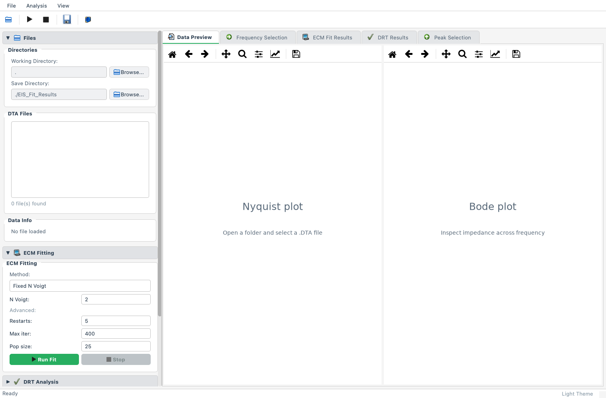

# Gamry EIS Fitter

**Explore impedance measurements, fit circuit models, and export clear results—from a desktop window or an interactive terminal.**

Gamry EIS Fitter is a Python tool for researchers, engineers, and students working with electrochemical impedance spectroscopy (EIS). It helps you compare a circuit model with your measurements, inspect where the fit differs, and save plots and numerical results.

Developed for Gamry EIS `.DTA` files containing a `ZCURVE TABLE` with `Freq`, `Zreal`, and `Zimag` columns.



## What you can do

- **Choose how you work:** use the desktop GUI or follow prompts in the terminal.
- **Inspect your measurements:** view Nyquist and Bode plots and select a frequency range.
- **Fit a circuit model:** choose the number of relaxation elements, compare model sizes, or guide the fit by selecting peaks.
- **Check residuals:** inspect differences between the model and your measurements, including a Kramers–Kronig residual check.
- **Explore relaxation times:** run distribution of relaxation times (DRT) analysis with adjustable regularization.
- **Share your results:** export plots as PNG images and numerical results as CSV and text files.

## Install

Use **Python 3.11 or 3.12**. Download this repository or clone it, then open a terminal in its top-level folder.

Create and activate a virtual environment:

```bash
python -m venv .venv
```

On macOS or Linux:

```bash
source .venv/bin/activate
```

On Windows PowerShell:

```powershell
.venv\Scripts\Activate.ps1
```

Install with the desktop interface:

```bash
python -m pip install ".[gui]"
```

For the terminal interface alone:

```bash
python -m pip install .
```

Dependencies are installed by these commands; the application does not install packages at startup. Executable installers are not included.

## Start fitting

### Desktop interface

```bash
eis-fit-gui
```

1. Choose the folder containing your `.DTA` files.
2. Select a file and inspect its plots.
3. Select a frequency range and inspect the KK residual check.
4. Choose a fitting method or run DRT analysis.
5. Review residuals, then export the results.

### Interactive terminal

```bash
eis-fit --data-dir ./data --output-dir ./results
```

Select a file from the numbered list, follow the plot prompts, then choose an analysis from the menu. Create `./data` and add your own compatible files before running this example.

The terminal interface also opens interactive plot windows, so **a graphical desktop is required**. It is not a headless batch interface. With no options, it searches the current directory and writes results to `EIS_Fit_Results/`.

```bash
eis-fit --help
```

## Understanding the results

The circuit combines a series resistance and inductance with one or more parallel resistor–constant-phase elements. It provides a mathematical description of impedance behavior. A good fit alone does not establish which physical process each element represents.

KK residual checks and DRT features are analysis aids. Review measurement conditions, frequency coverage, residual structure, parameter bounds, and whether the model is appropriate for your application. Automated tests use artificial inputs and do not establish experimental validity.

## Documentation

| Guide | What it covers |
| --- | --- |
| [User guide](docs/user-guide.md) | GUI and terminal workflows, exports, troubleshooting |
| [Supported files](docs/file-format.md) | Expected Gamry table structure, units, validation |
| [Methods and limitations](docs/methods.md) | Circuit equations, solver settings, KK and DRT assumptions |
| [Development](CONTRIBUTING.md) | Installation, tests, and contribution guidelines |
| [Release guide](docs/releasing.md) | Source packaging and GitHub publication |
| [Changelog](CHANGELOG.md) | Release notes |

## Status and license

Version **0.1.0** is an initial source release. Python 3.11–3.12 on Linux, Windows, and macOS are the CI targets. Local verification was performed on macOS with Python 3.11; the GitHub Actions matrix must run before broader platform compatibility is claimed.

Released under [GPL-3.0-only](LICENSE). Dependencies retain their own licenses; see [third-party notices](THIRD_PARTY_NOTICES.md). This project is not affiliated with or endorsed by Gamry Instruments.
